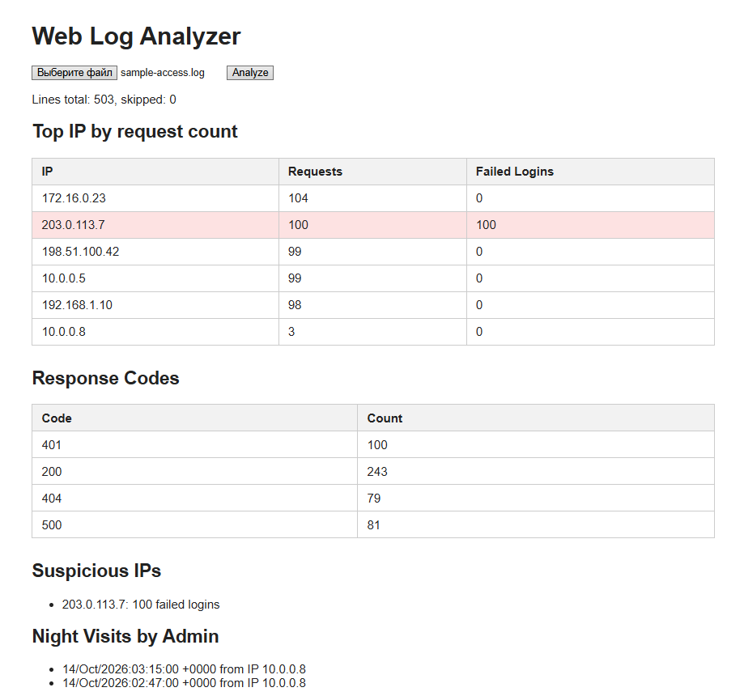

# web-log-analyzer

A small PHP tool that parses web server access logs (Apache/Nginx Combined format) and reports the most active IP addresses, response status distribution, and suspicious activity.



## Features

- Parses access log lines into structured data (IP, user, time, method, path, status, size)
- Counts requests per IP, per status code, and per path
- Detects possible brute-force attempts: IPs with more than 20 failed logins (401/403)
- Flags successful admin logins between 00:00 and 05:00

## Detection rules

These are heuristics, not final verdicts. A high number of failed logins may come from a misconfigured client, and a night login may be legitimate.

| Rule | Condition | Threshold |
|------|-----------|-----------|
| Brute-force suspicion | Failed logins (401/403) from one IP | more than 20 |
| Night admin login | Successful login (200) by user `admin` | between 00:00 and 04:59 |

## Requirements

- PHP 8.1 or newer
- No external dependencies

## Usage

Generate a sample log file:

```bash
php generate_sample_log.php
```

Start the built-in PHP server from the project folder:

```bash
php -S localhost:8000
```

Open `http://localhost:8000`, upload a log file, and click Analyze.

## Project structure

- `parser.php` - parses a single log line with a regular expression
- `analyzer.php` - reads the whole file and builds statistics and detection results
- `generate_sample_log.php` - creates a test log with random traffic and a simulated attack

## Input validation

The file input in the form uses `accept=".log,.txt"`, but this is only a hint for the user: the browser can be bypassed. The real check runs on the server. The analyzer parses each line, and if more than half of the lines cannot be parsed or the file is empty, it is rejected with an error message.

## Roadmap

- [x] Web interface with log file upload
- [ ] Date filtering
- [ ] Support for other log formats